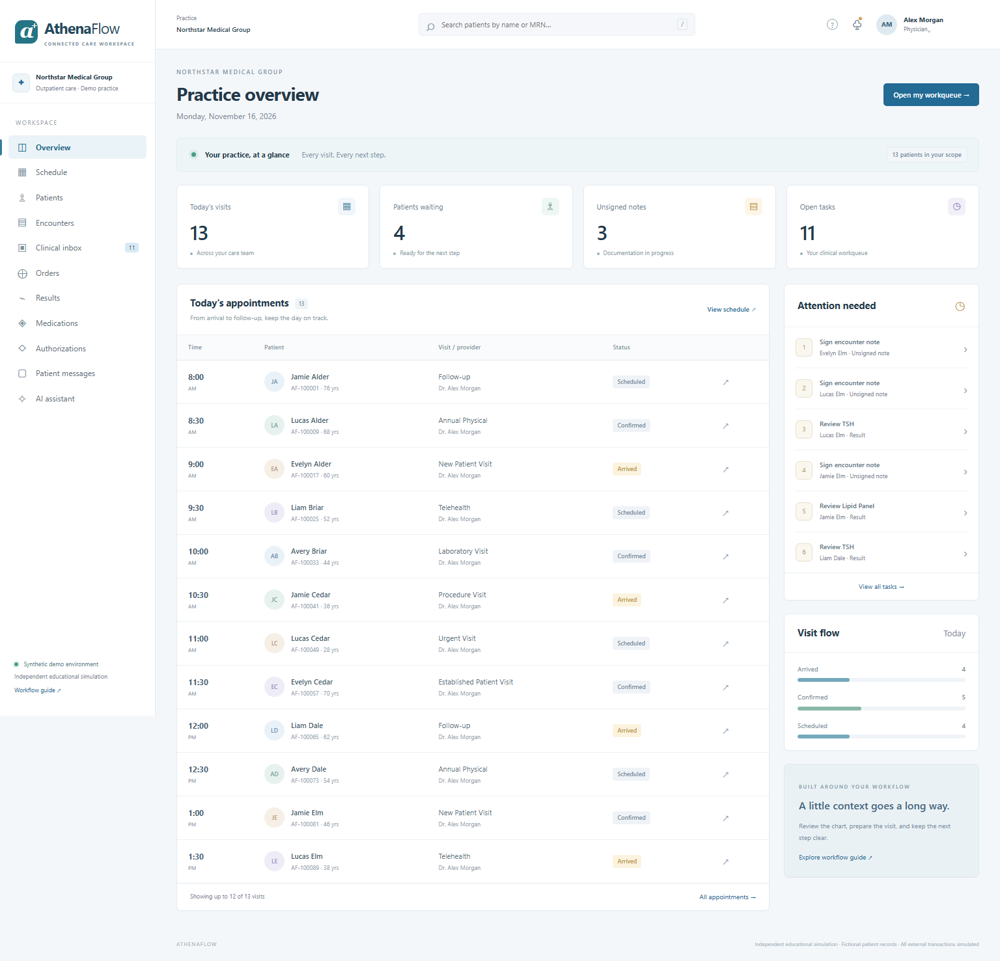
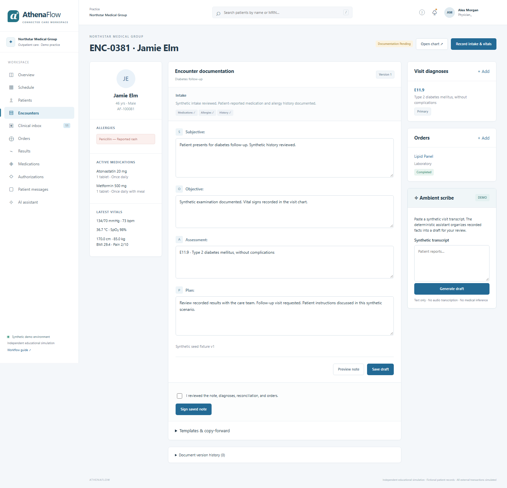
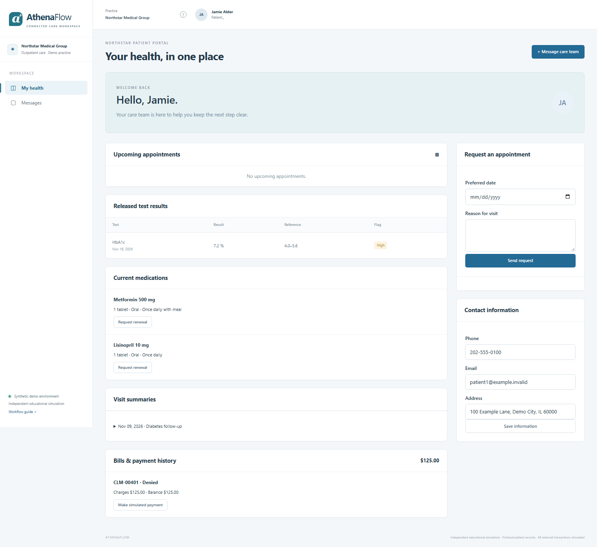

# AthenaFlow — Healthcare Practice Platform

An independent, educational Django simulation inspired by the **workflows** of athenaOne. AthenaFlow is not affiliated with athenahealth and contains no proprietary source, artwork, private APIs, real patient data, or external clinical connections.

The application connects registration, scheduling, clinical intake, physician documentation, orders, laboratory review, billing, simulated claims, and a patient portal. It is a working research prototype, **not a complete reproduction of the commercial product**. The feature inventory and limitations distinguish implemented workflows from simplified and missing requirements.



## V2 iteration

[Description V1](description_v1.md) preserves the original complete brief; [Description V2](description_v2.md) integrates the second iteration into a complete standalone specification. See the [V2 implementation and validation record](docs/v2-iteration.md) for coverage and migration behavior.

V2 adds searchable patient selectors, imperial/metric intake with automatic conversion, readable audit histories, explicit workflow states, per-user unread message badges, one-step message composition, reliable mobile logout, and confirmed patient responsibility before portal payment. Existing clinical and financial records are retained through additive migrations. Apply migrations before running the updated server; do not reset your existing demo database.

## Run locally

Requirements: Python 3.13 or 3.14 and an internet connection for the initial package installation. After installation, primary demonstration workflows run offline. SQLite is used locally; production requires PostgreSQL.

Windows PowerShell:

```powershell
./start.ps1
```

Or run the steps explicitly:

```powershell
python -m venv .venv
./.venv/Scripts/python.exe -m pip install -r requirements.txt
./.venv/Scripts/python.exe manage.py migrate
./.venv/Scripts/python.exe manage.py seed_demo
./.venv/Scripts/python.exe manage.py runserver 127.0.0.1:18310
```

macOS / Linux:

```bash
python3 -m venv .venv
source .venv/bin/activate
pip install -r requirements.txt
python manage.py migrate
python manage.py seed_demo
python manage.py runserver 127.0.0.1:18310
```

Open **http://127.0.0.1:18310/**. Do not use Django's development server for public hosting.

`seed_demo` is idempotent. It creates a fictional practice with 3 departments, 8 providers, 100 patients, 150 appointments, 100 encounters and notes, 100 diagnoses, 150 medications, 100 orders and results, 80 claims, 20 denials, 30 payments, 20 authorizations, 30 message threads, and 5 waitlist entries. The default anchor is the current date in America/Chicago. Use `--anchor-date 2026-11-16` for a fixed research fixture.

## Demo accounts

All listed accounts use the dedicated public password **`DemoCare2026!`**. These are fictional credentials, not secrets. The sign-in screen includes role selectors when `DEMO_MODE=true`.

| Username | Role | Suggested workflow |
|---|---|---|
| `admin.demo` | System administrator | All workspaces, configuration, staff, audit |
| `manager.demo` | Practice manager | Scheduling, operational and financial reports |
| `frontdesk.demo` | Front desk | Registration → coverage → schedule → check-in |
| `physician.demo` | Physician, Dr. Alex Morgan | Assigned charts, notes, orders, result review, scribe |
| `nurse.demo` | Nurse, Family Medicine | Intake, vitals, processing orders and results |
| `assistant.demo` | Medical assistant, Family Medicine | Intake, rooming, permitted chart observations |
| `billing.demo` | Billing specialist | Claims, denials, authorization, simulated payments |
| `coder.demo` | Coding specialist | Signed encounter charges and claim validation |
| `patient.demo` | Patient, Jamie Alder | Own summaries, released results, messages, bills |

Seven additional physician fixture accounts, `provider2.demo` through `provider8.demo`, use the same demo password. They preserve attribution for the other seven clinicians' signed historical notes. Accounts are assigned to their provider's department. No demo account has Django superuser status.

## What works

- Server-side authentication, role authorization, and patient/clinician assignment scoping.
- Searchable, sortable, paginated patient and workflow directories; registration with duplicate checks.
- Day/provider, week, and department schedule views, availability/conflict validation, appointment transitions, waitlist booking and portal request booking.
- Registration/eligibility/consent check-in gates; copay creation; automatic encounter and intake-task creation.
- Clinical intake, vital signs and BMI; SOAP drafts, version conflict detection, templates, preview, copy-forward provenance, explicit sign-off, locked signed notes, addenda and closure.
- Diagnoses, allergies, history, text documents, immunization entries, simulated prescriptions and warning acknowledgement.
- Orders → processing → entered result → published result → clinician review → portal release.
- Charge capture and approval; claim scrubbing and lifecycle; deterministic payer outcomes; denial appeal/correction; balance-checked, duplicate-protected simulated payments.
- Patient-specific messaging, appointment requests, pre-check-in, renewals, contact updates and receipt previews.
- Deterministic chart summaries and transcript-to-SOAP drafts with human approval. No paid API is needed.
- Database-derived reports and CSV export; FHIR R4-inspired JSON representations; staff configuration and audit history.

See [the feature inventory](docs/features.md) for exact boundaries, URLs and test coverage, and [the workflow guide](docs/workflows.md) for walkthroughs.

## Stack and structure

Django 5.2.19 LTS, Django templates, plain CSS/JavaScript, SQLite locally, PostgreSQL via `DATABASE_URL`, WhiteNoise static assets, Gunicorn for Linux hosting, Django tests and Playwright/Chromium.

```text
config/          Environment settings, routing, WSGI
core/            Organization, access policy, patients, scheduling, workflow services
clinical/        Encounters, notes, diagnoses, medications, orders, results
revenue/         Charges, claims, denials, authorizations, payments
engagement/      Tasks, messages, appointment requests, AI drafts
templates/       Responsive server-rendered workspaces
static/          Original design system and small progressive enhancements
tests/           Backend and real-browser regression tests
docs/            Architecture, schema, features, evaluation and limitations
```

The four domain apps deliberately replace the brief's suggested 25-app layout with a smaller modular monolith. Relationships remain normalized; transactional workflows are centralized rather than duplicated across views. Details are in [architecture](docs/architecture.md) and [database schema](docs/database-schema.md).

## Tests

```bash
pip install -r requirements-dev.txt
python -m playwright install chromium
python manage.py check
python manage.py makemigrations --check --dry-run
python manage.py test tests --verbosity 2
```

Run only backend tests with `python manage.py test tests.test_workflows`. Run browser tests with `python manage.py test tests.test_browser`. Set `CAPTURE_SCREENSHOTS=1` to update the representative screenshots. The browser suite uses an isolated Django live-server test database, not the working demo database.

The final suite contains **91 tests: 83 backend/integration and 8 Chromium browser tests**. All passed locally and in both Linux/SQLite and Linux/PostgreSQL jobs in the [verified CI run](https://github.com/KateK77/athenaone-clone/actions/runs/43990435586). See [testing and executed results](docs/testing.md) for exact environments, counts, execution times and unperformed evaluations.

## Deployment

`render.yaml` defines a paid Python web service and a separate persistent PostgreSQL database. It does **not** use ephemeral SQLite in production. Build installs dependencies, collects static assets, and runs production checks; pre-deploy runs migrations; the first-deploy hook initializes synthetic data.

1. Push this repository to GitHub and connect a new Render Blueprint to it.
2. Review the resources and current pricing before provisioning them.
3. Set `ALLOWED_HOSTS` to the allocated hostname, e.g. `athenaflow-demo.onrender.com`, and `CSRF_TRUSTED_ORIGINS` to its full HTTPS origin. A custom domain must be added to both lists.
4. Render generates `SECRET_KEY` and supplies `DATABASE_URL` from the database. `DEBUG=false`, `DEMO_MODE=true`, and `ALLOW_DEMO_RESET=false` are configured explicitly.
5. Check `/health/`, sign in, and exercise the deployment smoke workflow. Keep database backups and monitor resource usage.

The Blueprint was checked against Render's current JSON schema. No paid cloud resource is provisioned merely by downloading or running this project. Hosting and PostgreSQL have ongoing costs; permanently free hosting is not promised. A public demo exposes public demo credentials and shared synthetic state; never place real data in it.

Current references: [Render Blueprint specification](https://render.com/docs/blueprint-spec), [environment configuration](https://render.com/docs/configure-environment-variables), [compute plans](https://render.com/docs/compute-plans), and [Django 5.2 release notes](https://docs.djangoproject.com/en/5.2/releases/5.2/).

## Safe local demo reset

Reset is off by default. It is refused unless `DEBUG=true`, `DEMO_MODE=true`, `ALLOW_DEMO_RESET=true`, and the database is precisely this checkout's local `demo.sqlite3`. It also refuses a non-demo practice. PostgreSQL reset is never allowed by this command.

```powershell
$env:ALLOW_DEMO_RESET = 'true'
./.venv/Scripts/python.exe manage.py seed_demo --reset --confirm 'RESET SYNTHETIC DEMO'
```

An administrator-only UI exposes the same confirmed reset when enabled. It clears synthetic domain records and sessions, recreates fixtures, and records a reset event. Back up any research run results first. It does not erase non-demo user accounts.

## Screenshots

Screenshots below were captured from the running application during Playwright tests.




Additional captures: [sign-in](docs/screenshots/login.png), [schedule](docs/screenshots/schedule.png), [patient chart](docs/screenshots/patient.png), [claims](docs/screenshots/claims.png), [mobile navigation](docs/screenshots/mobile.png).

## Limits and research use

This is not HIPAA-certified, medically validated, or suitable for clinical use. No real payer, pharmacy, lab, payment, audio transcription, or LLM integration is implemented. The large original specification is **partially implemented**: real document uploads, comprehensive lab panels, advanced provider calendars, complete billing adjustment accounting, live LLM mode, and formal FHIR conformance remain outside this version. [Limitations](docs/limitations.md) and [research evaluation](docs/research-evaluation.md) identify these explicitly.
