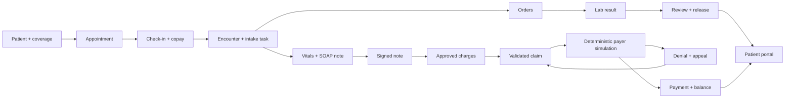

# Architecture report

## Scope and decisions

AthenaFlow is an original, synthetic educational application inspired by athenaOne workflow concepts. The source brief is preserved in `docs/original-brief.txt`. It is not a proprietary software reconstruction or an official athenahealth product.

The implementation uses a modular Django monolith with four domain apps, rather than the suggested 25 small apps. This reduces circular imports and repeated permissions logic while preserving relational entities. A shared view/form registry provides consistent table, filtering, editing, and detail behaviors. Dedicated workspaces handle scheduling, patient charts, encounters, portal, coding, reports and administration.

## Backend and frontend

- Django ORM models and checked-in migrations establish relational integrity.
- `core/services.py` owns multi-record workflow transitions, validation, audit events and transaction boundaries.
- `core/views.py` renders pages and routes POSTs to services. Views validate model forms, enforce role/record scope, reject locked record edits and redirect after successful writes.
- Django templates render semantic forms, labels, tables, navigation and alerts. UI actions require visible controls; no hidden API path is needed to complete the principal workflow.
- CSS uses an original white, pale blue, navy and teal enterprise design. Layouts adapt to narrow screens; tables scroll within their containers.
- Small JavaScript enhancements implement confirmation prompts, submit loading indicators, keyboard search, note preview, template prompts and mobile navigation. There is no frontend build step or third-party CDN dependency.

## Authentication and authorization

Django handles password hashing, sessions, CSRF, login and logout. A one-to-one `Profile` supplies one of nine roles. Superuser shortcuts are not used for demo accounts.

The `require` function enforces role permissions. Resource querysets are filtered through `patients_for`: patients see only their linked record; physicians see their primary or appointment-assigned patients; nurses and medical assistants see their department's patients. Physician encounter writes and schedule actions additionally require the assigned provider. Administrative and operational roles receive their defined practice-wide workspaces. Clinical documentation, results and medications are denied to front desk and billing roles. Coding uses a separate encounter view exposing diagnoses and charge capture.

ModelChoice fields use the same accessible patient/encounter scope. Backend relationship checks reject cross-patient diagnoses, orders, coverage and authorizations. Mutations are POST-only, with CSRF protection; patient-supplied IDs never determine scope by themselves. Signed SOAP content is protected in model saves and the workflow layer. Patient results require explicit release.

## Data and consistency

SQLite is the local development database. Production settings require PostgreSQL and a supplied secret. WhiteNoise serves collected immutable static assets; Gunicorn serves Django. Environment variables are explicit; `.env` is an example, not an automatically loaded file.

Appointments lock the provider row during conflict checking and booking. Encounter signing, claims, payer responses and payments use transactions and row locks. A claim is unique per encounter; charges are unique per encounter/procedure; payment references are unique. Payments must be positive, two-decimal amounts that do not exceed the locked balance. Note saves use a submitted version number and retain previous text in `NoteVersion`.

SQLite does not implement PostgreSQL row-lock semantics. This local demo is designed for low-concurrency use. Production concurrency behavior must be tested on PostgreSQL before relying on it for a larger research cohort.

Cross-module flow:

## AI

Only deterministic demo mode is implemented. The summary view reads chart facts and derives limited workflow reminders. The ambient-scribe demonstration accepts text and combines it with the complaint, recorded vitals and encounter diagnoses into an `AIDraft`. It does not infer a diagnosis, prescribe, create orders, or sign notes.

Approval applies the draft to an unsigned note through the normal versioned save path. The draft records model identifier `deterministic-demo-v1`, prompt version `soap-v1`, transcript, output, author, decision and timestamp. Placeholder text must be completed before note signing. Live LLM integration and actual audio transcription are absent.

## Audit and deployment

Audit events retain actor, entity, object ID, action, timestamp and structured transition metadata. They cover successful user mutations, sign-offs, exports, payment posting and workflow validation failures. The log is read-only through the application. It is not an external, cryptographically tamper-proof audit system. Not every invalid form or login attempt is separately persisted; server error reporting/central monitoring is not integrated.

The Render Blueprint separates web compute from persistent PostgreSQL and keeps reset disabled. It has been schema-validated, not deployed as part of the local build. CI configuration covers Linux SQLite and PostgreSQL; local executed results are recorded separately.

## V2 shared components

`core/presentation.py` formats structured events and currency without trusting HTML. `engagement/messaging.py` scopes incoming unread messages and records unique per-user read receipts. `VitalForm` validates unit conversions before metric model validation; vital rows retain selected display units. Claim patient responsibility is separate from total outstanding balance and confirmed by an audited billing action. `static/v2.css` provides responsive corrections; `static/app.js` progressively enhances native selectors, units and message badges.
